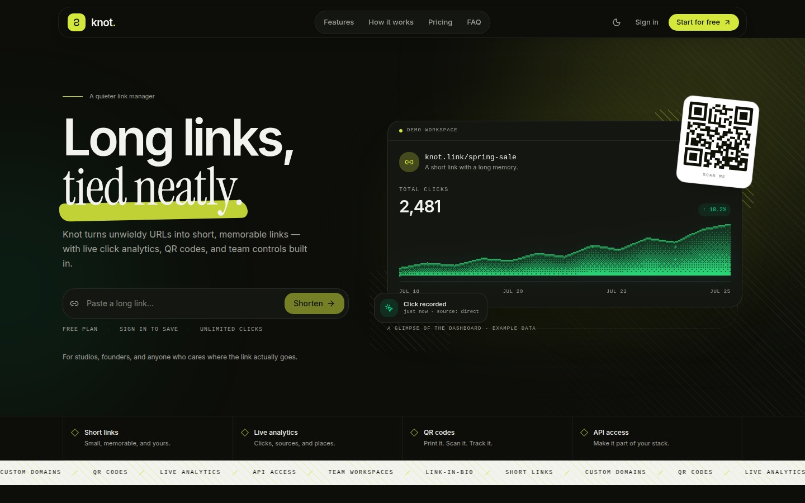
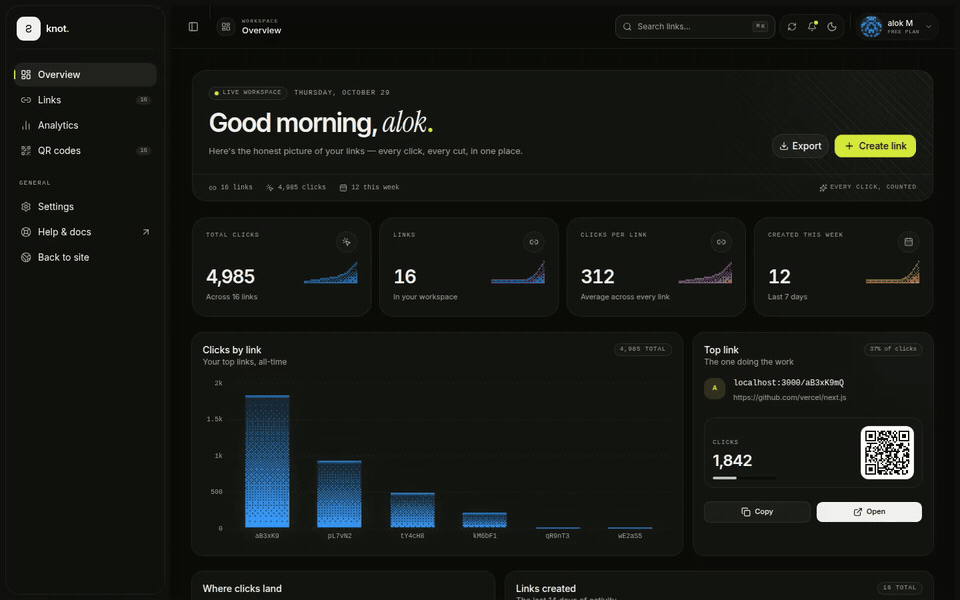
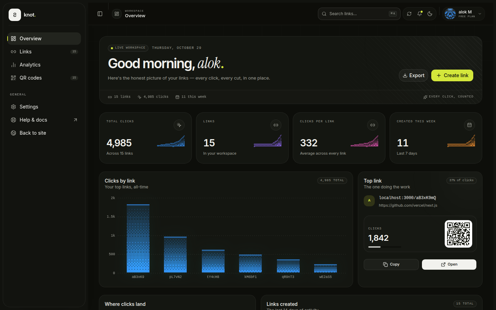
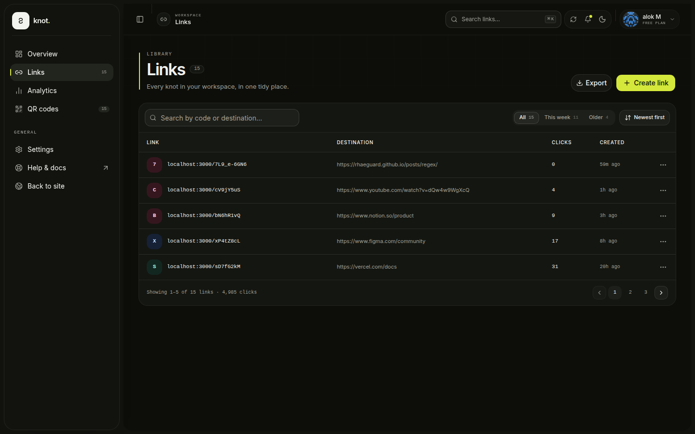
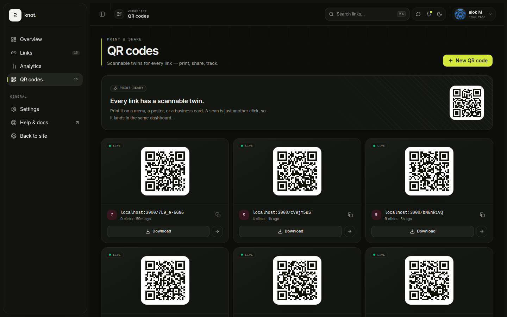
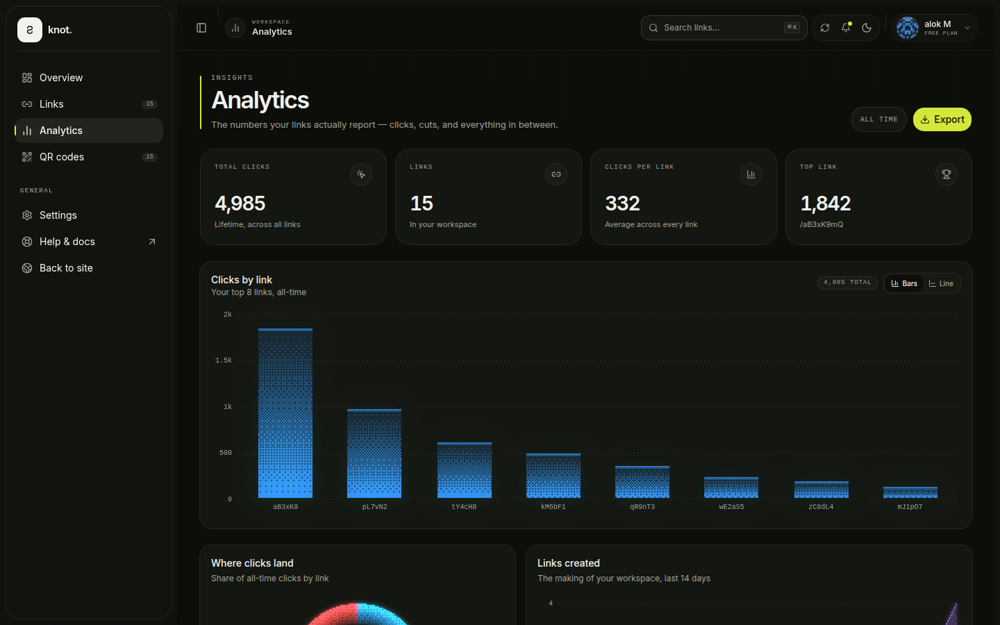
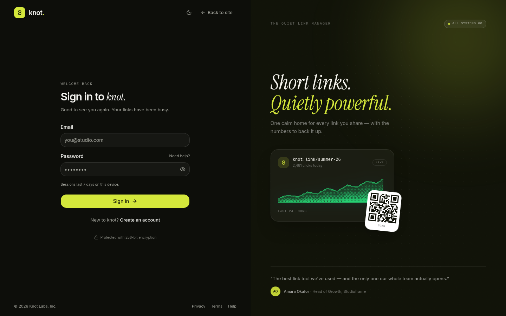
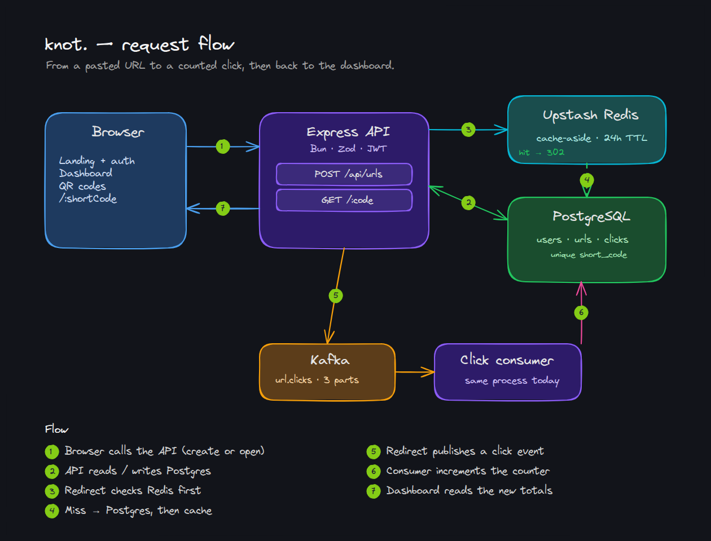
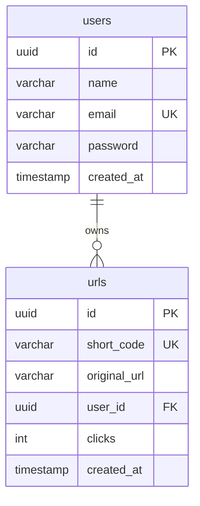

# knot.

**Long links, tied neatly.**

knot is a full-stack URL shortener: paste a long URL, get a short one, share it, and watch the clicks land in a real dashboard. It is built as a monorepo with a **TanStack Start + React 19** frontend and a **Bun + Express** API backed by **Postgres**, **Upstash Redis**, and **Kafka**.

<p align="center">
  
  
  
  
  
  
</p>

<p align="center">
  
</p>

> Screenshots use a demo workspace in dark mode. A fresh install starts with an empty dashboard.

**Jump to:** [Demo](#see-it-in-action) · [Features](#what-it-does) · [Screens](#a-look-around) · [How it works](#how-it-works) · [Architecture](#architecture) · [Scalability](#scalability) · [API](#api) · [Run locally](#run-it-locally) · [Scope](#scope-and-known-gaps)

## See it in action

<p align="center">
  
</p>

*15-second tour: create a link, browse the library and QR codes, then check analytics. [Watch the full-quality MP4](docs/demo/knot-demo.mp4).*

## What it does

- **Accounts that stay signed in.** Email + password registration and login, hashed with Bun's password API (argon2id). Sessions are 7-day JWTs in an `httpOnly`, `SameSite=Lax` cookie — no session table, no sticky sessions.
- **Short links without ceremony.** Paste any `http`/`https` URL and get a 10-character code. Codes are generated from a 65-character alphabet (~1.3 × 10¹⁸ combinations) and retried on the rare collision.
- **A dashboard with real numbers.** Totals, average clicks, top link, clicks by link, and links created over the last 14 days. Charts are computed from the rows the API actually returns.
- **A real link library.** Search by code or destination, filter by age, page through results, copy, open, and delete. CSV export is generated in the browser.
- **QR codes for every link.** Each code encodes the actual short URL and downloads as an SVG. Scans count as clicks because they hit the same redirect.
- **Light and dark themes** across the landing page, auth screens, and dashboard, with responsive layouts for desktop and mobile.
- **Click counting that stays off the redirect path.** Redirects publish an event to Kafka instead of updating the counter inline. A consumer increments the counter; if Kafka is unavailable, the API falls back to writing directly to Postgres.

The dashboard shows **lifetime click totals**, not per-click history. There is no referrer, device, country, or time-series tracking yet — see [Scope and known gaps](#scope-and-known-gaps).

## A look around

The visual language is deliberately quiet: Instrument Serif headlines, Inter for UI, a lime accent, hairline borders, and ordered-dither charts instead of the usual glossy dashboard gradients.

### Dashboard



### Links and QR codes

| Links | QR codes |
| --- | --- |
|  |  |

### Analytics and sign in

| Analytics | Sign in |
| --- | --- |
|  |  |

## How it works

### Creating a short link

1. A visitor signs up or signs in at `/signup` or `/login`.
2. The API verifies the password, signs a JWT, and sets it as an `httpOnly` cookie.
3. From the dashboard, the user pastes a long URL into **Create link**.
4. `POST /api/urls` validates the input with Zod (`http`/`https` only, max 2048 characters), generates a 10-character code, and inserts a row into `urls`.
5. The API returns the short URL and the dashboard shows a copy button and a QR code.
6. The link can be shared, printed, or downloaded as an SVG.

### Opening a short link

1. A browser requests `GET /:shortCode` on the API origin.
2. The code is validated and looked up in Redis under `url:<code>`.
3. On a cache hit, the API skips Postgres entirely.
4. On a miss, it reads the unique `short_code` index, then caches the destination for 24 hours.
5. A click event is published to Kafka (or written straight to Postgres if Kafka is down).
6. The browser receives a `302` redirect to the original URL.
7. The consumer increments `urls.clicks`, and the next dashboard refresh reflects it.



*Drawn in Excalidraw. The editable scene is [architecture.excalidraw](docs/diagrams/architecture.excalidraw) — download it and drag it into [excalidraw.com](https://excalidraw.com).*

Deleting a link removes the row (scoped to the owner) and invalidates its Redis key.

## Architecture

The request-flow diagram above shows the same pieces: the React client, the Bun API, Upstash Redis, PostgreSQL, Kafka, and the in-process click consumer.

The consumer currently runs inside the same process as the API. That keeps the local stack small; it is also the first thing to split out for scale.

### Stack

| Layer | Choice | Why |
| --- | --- | --- |
| Frontend | TanStack Start, React 19, Tailwind CSS v4, shadcn/ui (Base UI) | File-based routing, SSR, and a typed component system |
| API | Bun, Express 5, Zod | Fast startup, simple routing, schema validation at the edge |
| Auth | `jose` JWT + `Bun.password` | Stateless sessions with argon2id password hashing |
| Database | PostgreSQL 17 + Drizzle ORM | Relational integrity, typed queries, SQL migrations |
| Cache | Upstash Redis (REST) | Shared, managed cache that survives API restarts and replicas |
| Events | Kafka 3.9 + KafkaJS | Non-blocking click writes with a durable, replayable log |
| Charts | `dither-kit` | Ordered-dither chart fills that give the dashboard its visual identity |
| QR codes | `qrcode.react` | Client-side SVG generation from the real short URL |
| Infra | Docker Compose, multi-stage Bun image | One command for Postgres, Kafka, migrations, and the API |

### Data model



- `users.email` is unique, and passwords are stored as hashes.
- `urls.short_code` is unique and indexed by the constraint, which is what makes the redirect lookup cheap.
- `urls.user_id` cascades at the database level, so deleting a user row also removes their links.
- `clicks` is a denormalized counter: cheap to read, but every click is a write to the same row. That trade-off is covered below.

## Scalability

**Short version:** the redirect read path is designed to scale horizontally; the link-management and analytics paths are deliberately MVP-simple. This is a design review, not a load-test result.

### What already scales

- **The API is stateless.** JWTs are verified from the cookie, so any replica can serve any request. There are no in-memory sessions and no sticky load-balancing requirement.
- **Redirects mostly avoid Postgres.** The Redis cache-aside layer absorbs repeated traffic, and the cache is shared by every API instance. A cold key costs one indexed lookup; a warm key costs one Redis call.
- **Click writes are decoupled.** Publishing to Kafka means a redirect does not wait for a counter update. The consumer group can be scaled across partitions, and Kafka retains events if a consumer falls behind.
- **The key space is large.** A 65-character alphabet over 10 positions gives ~1.3 × 10¹⁸ codes, so collisions are rare and are handled with `ON CONFLICT DO NOTHING` plus retries.
- **Failures degrade instead of stopping.** If Kafka is unreachable the API still redirects and writes counters directly to Postgres.
- **The backend is containerized and configured by environment variables**, so the API can be replicated behind a load balancer without code changes.

### Where it breaks first

| Pressure point | Today | Why it matters | Next move |
| --- | --- | --- | --- |
| **Link list** | `GET /api/urls` returns every link for the user; the browser paginates | A large account downloads its whole portfolio on every dashboard load | Cursor pagination plus a `(user_id, created_at)` index |
| **Click counter** | One `UPDATE` per event | A viral link serializes on a single row lock; events for one code share a partition, so one consumer handles them | Buffer deltas in Redis and flush every few seconds, or store events in ClickHouse and aggregate |
| **Consumer placement** | Runs inside the API process | Redirect CPU and consumer CPU compete; scaling redirects also rebalances partitions | Deploy consumers as a separate worker service |
| **Abuse protection** | No rate limiting | Link creation, login, and redirects can all be scripted | Redis token bucket per IP/user, plus WAF/bot rules |
| **Database writes** | Single primary, one `pg` pool per process | Every replica adds connections; all writes hit one node | PgBouncer, read replicas for dashboard queries, partitioning only when proven necessary |
| **Unknown codes** | Cache misses always hit Postgres | Scanners and bots can generate repeated misses (cache penetration) | Short negative cache and request coalescing |
| **Geography** | Single region | Distant users pay a round trip on every redirect | Edge redirects via CDN/Worker with replicated KV or Redis |
| **Kafka durability** | One broker, replication factor 1 in Compose | A broker loss can drop click events | 3+ brokers, RF=3, `min.insync.replicas=2`, retries, and a dead-letter topic |
| **Observability** | `console` logs | Hard to find a slow link, a lagging consumer, or a failing replica | Structured logs, metrics, tracing, and alerts |

### The honest capacity picture

This setup is comfortable for a portfolio project and an MVP; with the fixes listed above, it is a reasonable starting point for early production. Normal dashboard traffic is small, and redirects are cheap because most of them never touch Postgres. The first real wall is **not** raw redirect QPS — it is **hot-link counter writes** and **unbounded list queries**. Fix those two before adding infrastructure.

At very high redirect volume, the natural next step is to move redirect resolution to the edge (CDN or edge worker + replicated KV) and keep Postgres as the control plane for accounts, link metadata, and aggregated stats.

### If I did three things next

1. **Paginate the link list on the server** and add the matching index.
2. **Batch click increments** so a popular link does not produce one row lock per click.
3. **Add rate limiting and observability** before exposing the API to real traffic.

After that: a dedicated click worker, a production Kafka cluster, read replicas for analytics, and edge redirects.

## API

| Method | Endpoint | Auth | Purpose |
| --- | --- | --- | --- |
| `GET` | `/health` | No | Health check |
| `POST` | `/api/auth/register` | No | Create an account and set the session cookie |
| `POST` | `/api/auth/login` | No | Sign in and set the session cookie |
| `POST` | `/api/auth/logout` | No | Clear the session cookie |
| `GET` | `/api/auth/me` | Yes | Return the current user |
| `POST` | `/api/urls` | Yes | Create a short link from `{ "url": "https://…" }` |
| `GET` | `/api/urls` | Yes | List the signed-in user's links |
| `DELETE` | `/api/urls/:id` | Yes | Delete one of the user's links |
| `GET` | `/:shortCode` | No | Redirect and record a click |

```bash
# Register and store the auth cookie
curl -c cookies.txt -X POST http://localhost:3000/api/auth/register \
  -H 'Content-Type: application/json' \
  -d '{"name":"Ada","email":"ada@example.com","password":"correct-horse-battery"}'

# Create a short link
curl -b cookies.txt -X POST http://localhost:3000/api/urls \
  -H 'Content-Type: application/json' \
  -d '{"url":"https://example.com/a/very/long/link"}'

# Follow it (records a click)
curl -i http://localhost:3000/<shortCode>
```

## Run it locally

### Prerequisites

- [Bun](https://bun.sh) 1.4+
- Docker with Compose
- A free [Upstash Redis](https://upstash.com) database (REST URL and token)

### 1. Start the backend stack

```bash
cd server
cp .env.example .env
```

Fill in `UPSTASH_REDIS_REST_URL`, `UPSTASH_REDIS_REST_TOKEN`, and a `JWT_SECRET` of at least 16 characters. Then:

```bash
make up
```

This builds the API image and starts Postgres, Kafka, the one-shot migration service, and the API. The API listens on <http://localhost:3000>; `curl http://localhost:3000/health` should return `{"status":"ok"}`.

Useful extras:

```bash
make logs                 # follow API logs
make kafka-ui             # Kafka UI at http://localhost:8080
make studio               # Drizzle Studio (prints a local.drizzle.studio link)
make down                 # stop everything (keeps data)
make wipe                 # stop and delete data volumes
```

See [server/README.md](server/README.md) for the full list of make targets.

### 2. Start the frontend

```bash
cd client
bun install
bun run dev
```

Open <http://localhost:3001> and create an account. Vite proxies `/api` to `http://localhost:3000`, so the auth cookie stays same-origin during development.

If the API is on another port:

```bash
API_PROXY_TARGET=http://localhost:4000 bun run dev
```

Short links are served by the API origin (`http://localhost:3000/<code>`), not by the Vite dev server.

### 3. Try it

1. Sign up at `/signup`.
2. Create a link from the dashboard.
3. Open the short URL in an incognito window.
4. Refresh the dashboard and watch the click count change.
5. Download the QR code from `/dashboard/qr-codes`.

## Project layout

```text
.
├── client/                       # TanStack Start frontend
│   ├── src/routes/               # file-based routes (landing, auth, dashboard)
│   ├── src/components/           # landing, dashboard, charts, UI primitives
│   └── src/lib/                  # API client, CSV export, formatting
├── server/                       # Bun + Express API
│   ├── docker-compose.yml        # Postgres, Kafka, API, migration job, optional UIs
│   ├── src/features/auth/        # register, login, logout, session middleware
│   ├── src/features/shorturl/    # create, list, delete, redirect, click recording
│   ├── src/db/                   # Drizzle schema and migrations
│   ├── src/lib/kafka.ts          # producer, consumer, click fallback
│   └── src/catch/redis.ts        # Upstash client
├── docs/
│   ├── demo/                     # 15-second product demo (GIF + MP4)
│   ├── diagrams/                 # Excalidraw source + rendered request flow
│   └── screenshots/              # dark screenshots used in this README
└── README.md
```

## Scope and known gaps

The landing page presents the product vision; the dashboard only displays data the API actually provides. Keeping that separation honest is deliberate.

**Working today**

- Email/password auth with cookie sessions
- Create, list, search, filter, paginate, copy, and delete links
- Lifetime click counts and dashboard/analytics charts derived from them
- CSV export of the user's links
- QR code generation and SVG download
- Redis cache-aside redirects
- Kafka click pipeline with a Postgres fallback
- Docker Compose stack with migrations and a health check

**Designed but not built yet**

- Custom domains and custom slugs
- Link editing, expiry dates, and password-protected links
- Per-click event history (referrer, device, country, time series)
- Team workspaces, roles, and shared folders
- Public API keys, webhooks, and usage-based plans
- Billing and plan-limit enforcement (the pricing section is presentational)
- Email verification and password reset
- Server-side pagination, rate limiting, and a negative cache
- Automated tests and CI

The charts show aggregate totals because that is what the schema stores. Storing individual click events would unlock real time-series analytics without changing the redirect path.

## More docs

- [client/README.md](client/README.md) — routes, API integration, theming, and frontend scripts
- [server/README.md](server/README.md) — Docker targets, Kafka behavior, migrations, and backend scripts
